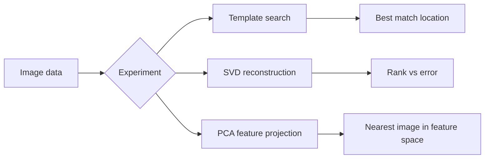
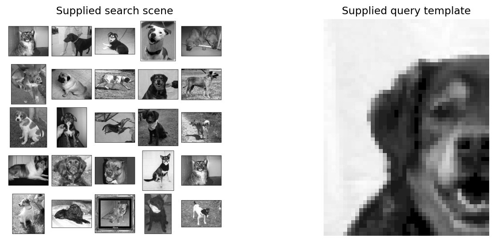
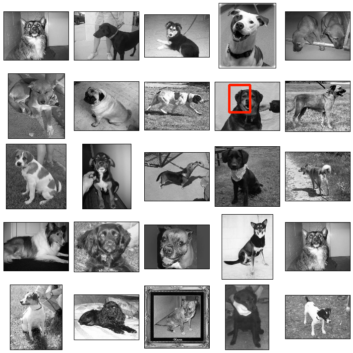
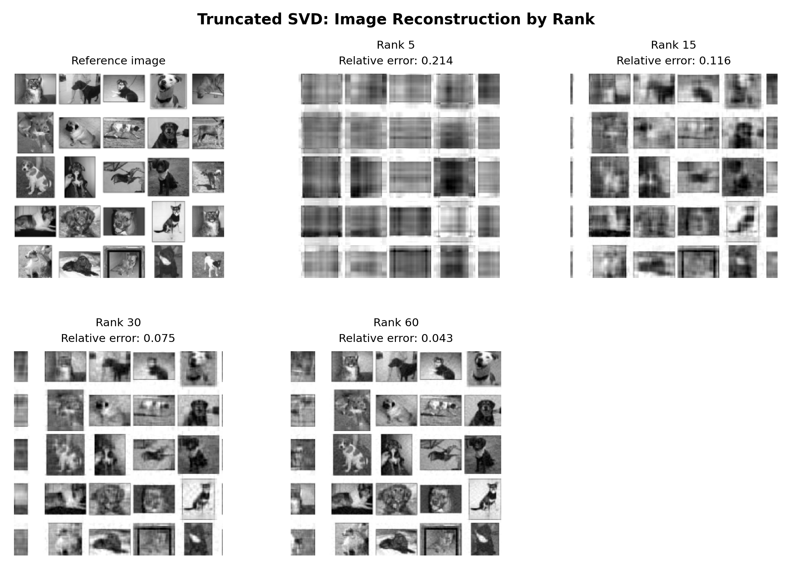
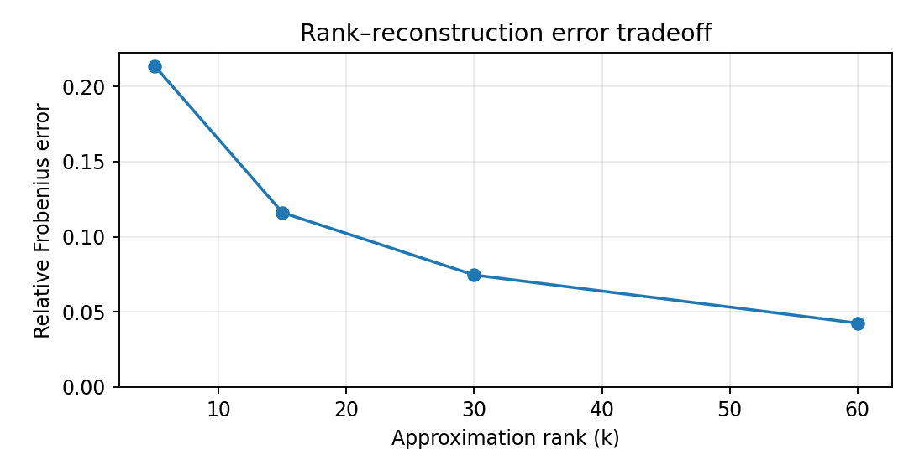

# Image Retrieval and Pattern Matching Through Linear Algebra

**Research + implementation portfolio | PCA · SVD · Template Matching · Computer Vision**

An integrated undergraduate research and programming project investigating how linear algebra enables **visual similarity search, low-rank image approximation, and face-image retrieval**. The project combines an extensive literature-based research report with practical Python experiments, a reproducible software interface, mathematical explanations and an additional offline analysis of real input images.

## Academic report 

**The complete English academic technical report is the central document of this repository.** It integrates the original undergraduate research and practical submission with documented portfolio extensions, derivations, numerical tables, and clearly bounded conclusions.

- **[Read the full academic report (PDF)](docs/ACADEMIC_REPORT.pdf)** — formatted for portfolio and academic review.
- **[Read the full academic report (Markdown)](docs/ACADEMIC_REPORT.md)** — accessible in GitHub with math blocks and in-line original result figures.
- **[Inspect recorded experiment tables](analysis/)** — CSV files for the supplementary noise and SVD-rank measurements.

This is an undergraduate research and implementation report, **not** a peer-reviewed paper or a claim of unmeasured recognition accuracy.

## Project highlights

| Track | Original project | Portfolio extension |
|---|---|---|
| **Research** | Extensive course manuscript covering classical and modern image retrieval | Structured English research synthesis with mathematical methods |
| **Template Matching** | SSD and custom-image searches | CLI interface, normalized correlation and noise robustness checks |
| **SVD** | Rank-limited image approximation (original ranks 5 and 15) | Multi-rank reconstruction comparison and relative-error curve |
| **PCA / Eigenfaces** | Olivetti nearest-image demonstration | Separate train/test images and explicit known-identity evaluation design |
| **Documentation / QA** | Original reports and source experiments | Reproducibility guide, limitations and automated mathematical tests |

## 1. The image-retrieval task

A query image or region is compared with one or more candidate images. **Template matching** locates a patch within a larger scene, while **PCA-based retrieval** searches for similar feature vectors in an image collection. **SVD** approximates the matrix representation of an image at lower rank; it demonstrates dimensionality reduction but is not itself a retrieval engine.



## 2. Visual experiments

### Experiment A — Finding a query patch



The search operates on the provided scene/template image pair. Below is a result generated by the cleaned code, not an accuracy benchmark.



### Experiment B — Image approximation with SVD





The rank sweep uses a resized version of the supplied scene. The numeric values and image dimensions are documented in [Experimental results](docs/EXPERIMENT_RESULTS.md). These measurements are **additional portfolio analyses**, distinct from the original coursework's rank-5/rank-15 examples.

### Experiment C — PCA / Eigenfaces retrieval

The original coursework demonstrated retrieval with PCA on Olivetti face images. The cleaned Python implementation now separates training and test images before fitting the PCA transform. **A measured held-out PCA accuracy is intentionally not claimed**, since the dataset-backed run remains unverified for this package.

## 3. Mathematical foundation

**Sum of squared differences (SSD)** searches for the minimum patch difference:

```math
\mathrm{SSD}(x,y)=\sum_{i=1}^{h}\sum_{j=1}^{w}[I(x+i,y+j)-T(i,j)]^2
```

**Singular value decomposition** gives a rank-limited approximation:

```math
A=U\Sigma V^T,\qquad A_k=\sum_{j=1}^{k}\sigma_j u_j v_j^T
```

**Principal component projection** transforms centered image vectors:

```math
z=W_k^T(x-\mu)
```

See [Research and methodology](docs/RESEARCH_AND_METHODS.md) for definitions, assumptions and distinctions between methods.

## 4. Reproducible implementation

Install Python dependencies:

```bash
python -m pip install -r requirements.txt
```

Locate a template in the sample scene:

```bash
python src/image_retrieval.py match --scene data/sample_scene.png --template data/sample_template.png --method correlation
```

Generate an SVD reconstruction:

```bash
python src/image_retrieval.py compress --image data/sample_scene.png --rank 15
```

Evaluate PCA retrieval on Olivetti (requires a first-time dataset download or cache):

```bash
python src/image_retrieval.py pca --components 50 --seed 42
```

Run tests:

```bash
python -m unittest discover -s tests -v
```

## 5. Validation and study boundaries

- Automated offline tests check elementary array operations; they do not establish recognition accuracy.
- The supplied-image correlation experiment is a **single paired-image example**; see [recorded offline findings](docs/EXPERIMENT_RESULTS.md).
- Olivetti PCA splitting is image-disjoint but **not identity-disjoint**: people seen in test images also appear in training images.
- SIFT, SURF, CNNs and Siamese networks are surveyed in the original research but **not implemented** in this repository.
- This project is neither biometric authentication nor a publication claiming improved state-of-the-art retrieval performance.

## 6. Documentation

| Document | Purpose |
|---|---|
| [Full academic report — PDF and Markdown](docs/ACADEMIC_REPORT.md) | Integrated theory, experimental methods, results, interpretation and references ([PDF](docs/ACADEMIC_REPORT.pdf)) |
| [Research & methodology](docs/RESEARCH_AND_METHODS.md) | Deeper explanation of objectives, equations and techniques |
| [Research overview](docs/RESEARCH_OVERVIEW.md) | Concise synthesis of the original academic report |
| [Experimental results](docs/EXPERIMENT_RESULTS.md) | Measured template-noise and SVD rank-sweep results |
| [Reproducibility guide](docs/REPRODUCIBILITY.md) | How to rerun and interpret the experiments |
| [Validation notes](docs/VALIDATION.md) | Verified evidence, limitations and next steps |
| [Original source scripts](archive/) | Archival scripts preserved separately from polished code |

## 7. Repository structure

```text
linear-algebra-image-retrieval/
├── README.md
├── requirements.txt
├── .gitignore
├── docs/ACADEMIC_REPORT.md + ACADEMIC_REPORT.pdf
├── src/image_retrieval.py
├── tests/test_math.py
├── analysis/README.md
├── data/
│   ├── sample_scene.png
│   └── sample_template.png
├── docs/
│   ├── RESEARCH_OVERVIEW.md
│   ├── RESEARCH_AND_METHODS.md
│   ├── EXPERIMENT_RESULTS.md
│   ├── REPRODUCIBILITY.md
│   ├── VALIDATION.md
│   └── images/
└── archive/
    ├── original_face_experiment.py
    └── original_custom_image_experiment.py
```

## 8. Future research directions

A more rigorous extension would benchmark top-k retrieval on labeled queries, compare runtimes and robustness under perturbations, test different PCA dimensions and random splits, and analyze identity-disjoint retrieval separately. The original work provides a basis for such experiments, but the repository does **not** present unperformed tests as completed results.

## Attribution and usage

**Primary student researcher and original implementation author: Hannane Ahmadi (@hanahmdi).** The original research manuscript and proposal were written for a Linear Algebra course. This repository provides English presentation material and keeps original experiment scripts in `archive/`; the Persian coursework reports are not included in this public package.

No license is included. Public visibility does not imply permission for reuse. **Review rights to supplied sample images before publishing publicly.**
