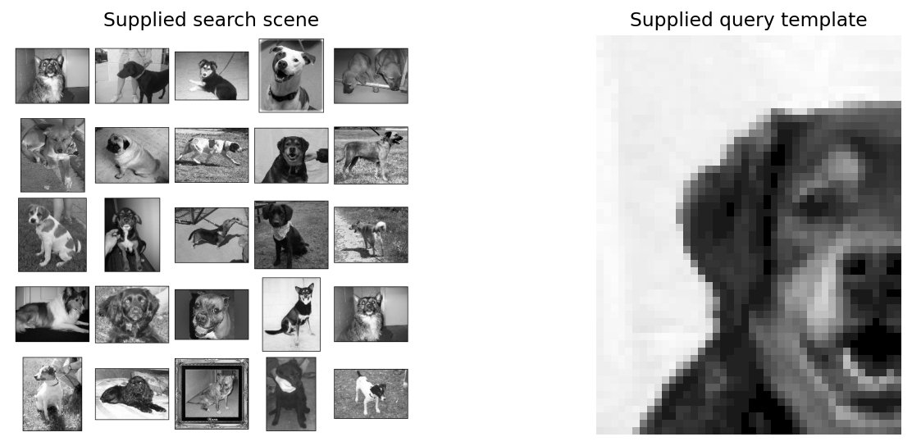
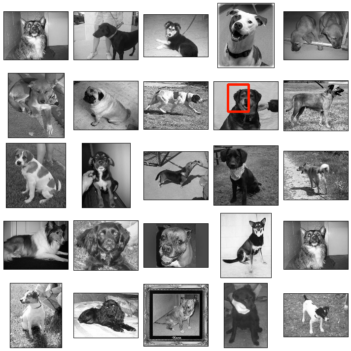
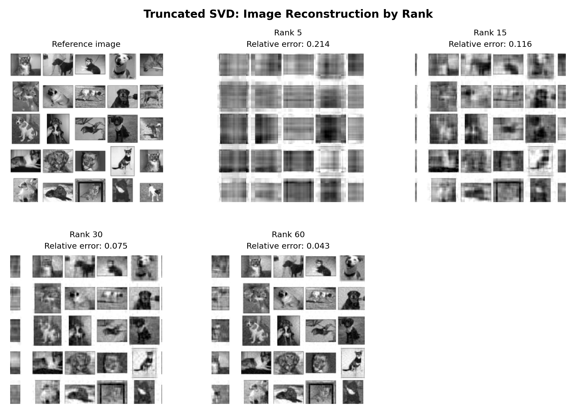
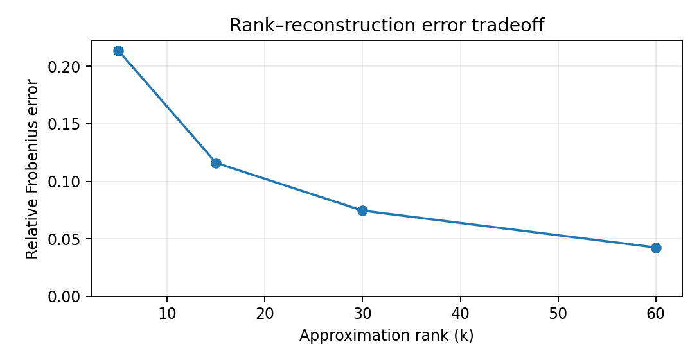

# Image Retrieval and Pattern Recognition Through Linear Algebra

**An integrated undergraduate research and experimental study of template matching, singular value decomposition, and principal component analysis**

**Hannane Ahmadi**  
Principal student researcher, original coursework author and implementation developer  
Electrical Engineering (Control) — Linear Algebra Course  
Research manuscript: December 2025 (Azar 1404) · Portfolio edition: November 2026

**Report type:** Undergraduate technical report and reproducible portfolio extension (not a peer-reviewed article)

---

## Abstract

Image retrieval involves identifying relevant images or local image regions from visual data. This study connects the linear-algebraic representation of images to three demonstrative computational methods: sum-of-squared-differences (SSD) template matching, low-rank image reconstruction using singular value decomposition (SVD), and principal component analysis (PCA) for nearest-neighbor retrieval of face images. The research component synthesizes image representation, preprocessing, traditional local features (SIFT and SURF), region matching, similarity metrics, and selected deep-learning approaches. The practical component preserves the original student's Python experiments and adds a cleaned command-line implementation, image-disjoint PCA evaluation logic, elementary automated tests, and illustrative offline measurements. On one supplied scene/template pair, normalized correlation decreased from 0.99605 to 0.92746 under template Gaussian noise with standard deviations of 0 and 30 intensity units, while the best-match location remained (462, 171). For the resized sample image, relative Frobenius SVD reconstruction error decreased from 0.21357 at rank 5 to 0.04251 at rank 60. These are **single-image demonstrations**, not dataset-level accuracy estimates. A held-out Olivetti PCA accuracy has **not** been independently verified for this release. The study illustrates the value and limitations of matrix methods while distinguishing research survey material from tested implementation.

**Keywords:** Linear algebra; image retrieval; template matching; SSD; normalized correlation; SVD; low-rank approximation; PCA; eigenfaces; reproducibility.

## 1. Introduction

### 1.1 Background and motivation

A grayscale digital image is an array of intensity samples, and a collection of images can be represented as a matrix whose rows correspond to vectorized observations. This elementary correspondence makes linear algebra fundamental to computer vision: dot products enable similarity scoring, matrix factorizations expose low-dimensional structure, and projections encode images in compact coordinate systems. Image matching nevertheless becomes harder when illumination, viewpoint, position, scale, occlusion or noise changes. The original course research addressed the challenge of locating a specific image among a collection and surveyed both conventional and newer approaches to image representation and recognition.

This portfolio edition deliberately separates four layers of evidence: (i) **research survey** from the original manuscript and proposal; (ii) **historical coursework implementation** from the submitted practical archive; (iii) **cleaned and expanded software** prepared for reproducible execution; and (iv) **new offline measurements** on the supplied image pair. This distinction prevents broad literature claims from being mistaken for verified performance of the student code.

### 1.2 Research questions

1. How does a sliding-window pixel-distance metric locate a template in a scene, and how does its behavior change when template noise increases?
2. How does truncating the singular-value spectrum trade image fidelity for rank reduction?
3. How does PCA map face images into a compact feature space for nearest-neighbor retrieval, and what experimental separation is needed for meaningful evaluation?
4. Which classical and learned retrieval methods are covered by the literature review, and which are actually available in the software?

### 1.3 Contributions and boundaries

The original coursework includes a literature-based report and practical explorations of SSD template localization, SVD reconstruction at selected ranks, PCA/eigenfaces on Olivetti faces, and image matching with OpenCV. The **portfolio extensions** provide a structured command-line interface, basic tests, fixed-seed template-noise study, multi-rank SVD error assessment, clearer PCA split methodology, English research documentation and implementation guidance. No new trained deep network, new benchmark dataset, demonstrated biometric authentication system or experimentally verified state-of-the-art accuracy is claimed.

## 2. Research context and literature synthesis

### 2.1 Image representation and preprocessing

The original research manuscript examines binary, grayscale and RGB image representations and introduces filtering, histogram-based contrast adjustment, gradient operators and edge detection as preprocessing steps. These techniques can improve readability or isolate structure but may also change the features used by a subsequent matcher. In a grayscale image of height H and width W, the intensity matrix A belongs to R^(H×W); vectorization yields an element of R^(HW). An image collection of N equal-sized grayscale images may be organized as X in R^(N×HW). Standardizing shape, intensity range and preprocessing is essential before Euclidean distance or PCA projection is meaningful.

### 2.2 Traditional local features: SIFT and SURF

The original review covers Scale-Invariant Feature Transform (SIFT) and Speeded-Up Robust Features (SURF), keypoint/descriptor methods designed to support matching when exact pixel alignment is impractical. SIFT detects scale-space features and builds orientation-aware descriptors; SURF uses approximations based on integral-image and Hessian-related operations to accelerate feature extraction. They are important **review topics**, not modules implemented in this repository. Local feature matching differs conceptually from a single-template SSD scan, since it uses correspondences among local descriptors rather than direct patchwise intensity equality.

### 2.3 PCA, SVD and retrieval

PCA estimates directions of high variance in a dataset and permits a low-dimensional coordinate representation for matching. SVD factorizes a matrix and is useful for principal directions and low-rank approximation. In the image-compression experiment, SVD is used on **one image matrix** to approximate its pixel values; in the PCA experiment, the data matrix consists of **many vectorized face images**, with dimensions learned from training images. These are different tasks even though both rely on singular vectors.

### 2.4 Modern methods reviewed but not executed

The thesis also surveys convolutional neural networks (CNNs), transfer learning, Siamese networks, recurrent/attention-based architectures and generative adversarial networks (GANs). Deep learned embeddings can address some appearance changes that defeat direct pixel matching, but deployment requires data, training choices and careful evaluation. No CNN, Siamese model, transformer or GAN was trained or benchmarked in the submitted practical files or portfolio code. Literature coverage must not be read as evidence of their implementation.

### 2.5 Method-to-task comparison

| Method | Input and objective | Typical output | Implemented here? | Main limitation in this study |
|---|---|---|---|---|
| SSD patch matching | Query patch + larger scene | Minimum-distance position | Yes | Sensitive to alignment and illumination |
| Normalized correlation | Query patch + larger scene | Maximum similarity position | Yes | Limited invariance to scale and rotation |
| Truncated SVD | Single grayscale image | Rank-k reconstructed image | Yes | Reconstruction is not retrieval by itself |
| PCA + nearest neighbor | Collection of face image vectors | Closest training identity/image | Yes (run unverified) | Known-identity, dataset-dependent setting |
| SIFT/SURF | Images with local structures | Descriptor correspondences | Literature only | No implementation or benchmark |
| CNN / Siamese embeddings | Learned image features | Class scores or learned distances | Literature only | Requires training and held-out evaluation |

## 3. Mathematical foundations

### 3.1 Template matching by SSD

Let T be a template of size h×w and I the scene. The cost at pixel offset (x,y) is

```math
\mathrm{SSD}(x,y)=\sum_{i=1}^{h}\sum_{j=1}^{w}\left[I(x+i,y+j)-T(i,j)\right]^2.
```

The chosen location minimizes this cost over valid offsets. SSD uses the absolute difference of corresponding intensity samples and is affected by changes in lighting, contrast and geometric alignment. Some libraries implement equivalent squared-difference matching with related normalization options; comparing their raw scores requires matching conventions.

### 3.2 Normalized cross-correlation

Normalized cross-correlation compares **centered** patches, scaling by their contrast magnitudes:

```math
\mathrm{NCC}(x,y)=\frac{\sum_{i,j}(I_{x,y}(i,j)-\bar I_{x,y})(T(i,j)-\bar T)}{\sqrt{\sum_{i,j}(I_{x,y}(i,j)-\bar I_{x,y})^2\;\sum_{i,j}(T(i,j)-\bar T)^2}}.
```

For a nonconstant template and nonzero patch variance, its ideal range is [-1,1]. A high score is **a similarity measure**, not a calibrated probability that an object exists. The cleaned implementation uses OpenCV `TM_CCOEFF_NORMED` and rejects a constant template.

### 3.3 Singular value decomposition and reconstruction

For A in R^(m×n), SVD writes

```math
A=U\Sigma V^T,\qquad A_k=\sum_{i=1}^{k}\sigma_i u_i v_i^T.
```

The truncated reconstruction A_k retains k singular components. By the Eckart–Young–Mirsky theorem, it minimizes the Frobenius reconstruction error among matrices of rank at most k. Here the reported normalized reconstruction error is

```math
E_k=\frac{\|A-A_k\|_F}{\|A\|_F}.
```

This is a **matrix approximation metric**, not a measured compressed image file size or bitrate. An actual file-size comparison would require specifying quantization, storage and coding overhead.

### 3.4 PCA / eigenfaces

Let x_i be vectorized training face images, and let mu be the training-set mean. PCA estimates orthonormal feature directions W_k from training data only and transforms each image to a k-dimensional representation:

```math
z_i=W_k^T(x_i-\mu),\qquad \widehat{j}=\arg\min_j\|z_q-z_j\|_2^2.
```

The nearest-neighbor label of query q is the identity assigned to the closest eligible training example. This is a simple *closed-set, known-identity* experiment when every test identity occurs in training. It is not biometric verification, unfamiliar-person identification or a measure of robustness to demographic and environmental changes. Fitting PCA before splitting queries and training examples would leak test-image information into the feature space.

## 4. Materials, sources and reproducibility

### 4.1 Original course materials

The source basis comprises the student's proposal, an approximately 50-page Persian research manuscript, the submitted practical report and the original Python scripts in the supplied practical archive. The research manuscript surveys traditional and modern retrieval methods; the practical submission implements selected examples. The portfolio edition preserves the archival code separately from the cleaned implementation. The original Persian reports are not redistributed in this public-ready package.

### 4.2 Supplied images and datasets

The portfolio folder contains `data/sample_scene.png` and `data/sample_template.png`, sourced from the practical submission. The noise analysis reuses this **single scene/template pair**. SVD reconstruction uses a grayscale version of the supplied scene, resized to fit a maximum image dimension of 300 pixels for this supplementary analysis. The PCA script accesses the scikit-learn Olivetti faces dataset on demand; downloading/cache availability and the dataset's reuse terms must be verified by the end user.

### 4.3 Code and environment

The cleaned executable script is `src/image_retrieval.py`, with `match`, `compress` and `pca` subcommands. Dependencies are described in `requirements.txt`; it is a compatibility-range file, not an exact-lock environment. Reproduce numerical experiments using a fixed seed, unchanged source images, documented preprocessing and the same algorithmic conventions. Tests are available in `tests/test_math.py`, covering simple synthetic patch matches and rank-reconstruction properties.

### 4.4 Evidence hierarchy

| Evidence class | What it establishes | What it does not establish |
|---|---|---|
| Original course PDF | Research scope, conceptual study and historical outcomes | Independently reproduced numerical performance |
| Original `.py` files | Historical implementation approach | Correctness on unseen datasets |
| Cleaned CLI and unit tests | Executable interfaces and elementary invariants | End-to-end retrieval accuracy |
| Fixed-seed offline study | Sample-specific positions and numerical errors | General robustness, clinical or biometric accuracy |
| PCA evaluation code | Image-disjoint split and training-only fitting procedure | Measured accuracy without a completed run |

## 5. Experimental methods

### 5.1 Experiment A: patch localization and noise

A fixed query patch is searched within the supplied image using both SSD (minimization) and normalized correlation (maximization). Gaussian noise with zero mean and standard deviation 0, 5, 10, 20 or 30 grayscale intensity units is applied to the **template**, while the scene is held fixed. The pseudorandom number generator uses seed 42. The maximum-correlation location and minimum-SSD location are recorded. This experiment measures perturbation response for **one pair**; it does not include an independent labeled benchmark.





### 5.2 Experiment B: rank-limited reconstruction

The selected grayscale image is resized to a maximum dimension of 300 pixels, then decomposed by SVD. Rank-5, rank-15, rank-30 and rank-60 reconstructions are compared with the resized input. For each rank, relative Frobenius reconstruction error is calculated. These four ranks extend the earlier coursework, where limited ranks were illustrated. No optimized entropy coding, memory throughput or compressed-file-size experiment is claimed.





### 5.3 Experiment C: PCA-based face image retrieval

The original practical experiment applied PCA to Olivetti face images and compared projected query features to the available images. The original fit included query images in the PCA estimation, so its results should be interpreted as a same-dataset illustration, not an independent test. The cleaned code uses a stratified **image-disjoint** train/test split, fits PCA on training images only and performs Euclidean nearest-neighbor matching on projected features. The split is **identity-overlapping**: the same identities are represented in both partitions. In this edition, the dataset-based command remains available, but an independently confirmed numerical accuracy result is not supplied.

### 5.4 Experiment D: custom-image matching

The original separate script searched for a target patch within a custom scene using OpenCV normalized correlation. The `archive/` directory preserves that historical approach. Its displayed match score must not be treated as a calibrated recognition confidence. The cleaned `match` command generalizes the input path and saved output location.

## 6. Results

### 6.1 Template-location stability for the supplied pair

| Gaussian noise standard deviation | SSD best location | SSD score | NCC best location | NCC score |
|---:|---|---:|---|---:|
| 0 | (462, 171) | 104832 | (462, 171) | 0.99605 |
| 5 | (462, 171) | 153268 | (462, 171) | 0.99405 |
| 10 | (462, 171) | 316988 | (462, 171) | 0.98762 |
| 20 | (462, 171) | 940992 | (462, 171) | 0.96418 |
| 30 | (462, 171) | 1974420 | (462, 171) | 0.92746 |

The best location stayed fixed at (462,171) for these five **template-noise settings**. Correlation declined smoothly from 0.99605 to 0.92746; SSD increased. These scores have different scales and opposite optimization directions and should **not** be compared numerically across metrics. This does not demonstrate tolerance to rotation, scale changes, independent camera scenes or unseen templates.

### 6.2 SVD approximation results

| Retained rank k | Relative Frobenius error |
|---:|---:|
| 5 | 0.21357 |
| 15 | 0.11600 |
| 30 | 0.07450 |
| 60 | 0.04251 |

Increasing retained rank improved reconstruction fidelity monotonically in the measured rank sweep. The decrease from 0.21357 to 0.04251 is a reduction in **relative matrix reconstruction error**. Because only one image was tested at resized resolution, the numbers are descriptive rather than universal. The comparison reflects the expected behavior of truncated SVD, but the measured improvement cannot be converted directly into compression ratios.

### 6.3 PCA results and missing measurements

The supplied practical files support a qualitative Eigenfaces demonstration. The portfolio extension specifies a more appropriate evaluation protocol, but **no independently completed Olivetti run or held-out accuracy percentage is included**. Consequently there is no verified confusion matrix, top-1 recognition percentage, top-k retrieval curve or confidence interval to report. These are identified as future validation tasks rather than filled with inferred results.

### 6.4 Automated checks

The repository contains three elementary tests related to template matching and SVD mathematics. They exercise synthetic inputs and expected structural properties; they are not a substitute for evaluation on a labeled image-retrieval dataset. See `tests/test_math.py` and `docs/VALIDATION.md` for test definitions and scope.

## 7. Discussion

### 7.1 Interpretation across tasks

The experiments reveal three distinct uses of linear algebra. Template matching uses inner-product-like comparisons and squared distances to rank spatial offsets within one image. SVD approximates the pixels of a single matrix with a lower-rank representation, giving interpretable information-loss curves. PCA learns a shared subspace across multiple training observations, enabling feature-based nearest-neighbor comparison. These methods are not interchangeable: an SVD reconstruction figure is not evidence of successful retrieval, and a high template correlation value is not a recognition probability.

### 7.2 Robustness and generalization

The fixed scene test suggests that the chosen example remains locatable when noise is added to its template up to the tested levels. Generalization requires more varied query–scene pairs, independent ground-truth locations, changes in lighting, rotations, scale and backgrounds, and repeated randomized trials. PCA evaluation must additionally isolate queries before learning components; even then, an identity-overlapping split supports only retrieval among known training identities. A stronger protocol would include a disjoint-identity evaluation for embedding generalization, which is a different and more demanding task.

### 7.3 Scientific limitations

The undergraduate source manuscript is a literature-oriented report, not a peer-reviewed empirical paper. The archived practical files contain small demonstrations rather than a standardized benchmark. The new offline results are obtained on one supplied image pair. The sample's reuse rights must be confirmed. MATLAB-like theoretical equivalences do not establish runtime savings on this codebase, and no claims about deployment scale, latency, security or identity authentication are supported. Results depend on preprocessing, source data and implementation conventions.

### 7.4 Strengthening the study

A credible next round would assemble an openly licensed, labeled collection of scenes and templates; log ground-truth locations; evaluate location error and recall at different geometric perturbations; compare correlation/SSD with consistent runtime benchmarks; test SVD reconstructions across diverse images; and run PCA on Olivetti with recorded versions and several fixed seeds. Confidence intervals should accompany comparative dataset scores when sample size permits. Learned descriptors and deep models could then be added as separate, explicitly trained baselines.

## 8. Reproducibility guide

From the repository root, install and test:

```bash
python -m pip install -r requirements.txt
python -m unittest discover -s tests -v
```

For patch search, run:

```bash
python src/image_retrieval.py match --scene data/sample_scene.png --template data/sample_template.png --method correlation --output outputs/match.png
```

For an illustrative SVD reconstruction, run:

```bash
python src/image_retrieval.py compress --image data/sample_scene.png --rank 15 --output outputs/svd_rank15.png
```

For the PCA command (external dataset download/cache may be needed), run:

```bash
python src/image_retrieval.py pca --components 50 --seed 42
```

Before publishing output from the PCA command, record train/test counts, PCA dimension, random seed, package versions and actual program output. This report does **not** include a substituted or hypothetical PCA accuracy result.

## 9. Conclusion

The combined coursework and portfolio extension show how matrix-based tools contribute to image search and representation. SSD and normalized correlation locate a local template under restricted alignment assumptions; truncated SVD characterizes low-rank approximation quality; and PCA yields a subspace in which face images can be compared by nearest-neighbor distance. Supplementary noise and rank-sweep experiments document tangible numerical patterns on the supplied data, but do not establish dataset-level accuracy or universal robustness. The strongest contribution of the project is its integration of foundational research, original coding exercises, transparent numerical analysis and a reproducible presentation. Future work should prioritize independently verified PCA results, more extensive ground-truth datasets and cross-method benchmarks.

## Acknowledgments and authorship

**Hannane Ahmadi** is credited as the original student researcher, author of the university research manuscript and original practical implementation. The present portfolio edition incorporates supplementary code cleanup, reproducibility support, additional offline experiments and newly written English technical presentation. Any reused third-party dataset or figure should be credited under its applicable terms. The original coursework names Dr. Saeed Ebadollahi as course instructor/supervisor; this does not imply endorsement of this updated portfolio edition.

## References and source provenance

**Source documents (primary material).**

1. Ahmadi, H. *Finding a Specific Image Among a Group of Images* (Persian research proposal, Linear Algebra course, submitted material).
2. Ahmadi, H. *Image Retrieval / Image Recognition* (Persian undergraduate course research manuscript, Azar 1404 / December 2025, approximately 50 pages).
3. Ahmadi, H. *Linear Algebra Practical Project* (Persian practical report and submitted Python implementation, supplied archive).
4. Ahmadi, H. *Code report and custom-image experiment* (submitted practical archive).

**Background references (well-established methodological sources; not claims of independently reproduced results).**

5. Turk, M. and Pentland, A. (1991). "Eigenfaces for Recognition." *Journal of Cognitive Neuroscience*, 3(1), 71–86.
6. Lowe, D. G. (2004). "Distinctive Image Features from Scale-Invariant Keypoints." *International Journal of Computer Vision*, 60, 91–110.
7. Bay, H., Ess, A., Tuytelaars, T. and Van Gool, L. (2008). "Speeded-Up Robust Features (SURF)." *Computer Vision and Image Understanding*, 110(3), 346–359.
8. Jolliffe, I. T. (2002). *Principal Component Analysis*, 2nd ed. Springer.
9. Eckart, C. and Young, G. (1936). "The Approximation of One Matrix by Another of Lower Rank." *Psychometrika*, 1, 211–218.
10. Szeliski, R. (2022). *Computer Vision: Algorithms and Applications*, 2nd ed. Springer.

**Bibliography note.** The original Persian report contains additional loosely specified reference entries. Rather than invent bibliographic metadata, this edition cites the original manuscript as a primary document and lists only identifiable standard background works here. This bibliography is a curated portfolio list, not a claim that every item in the original manuscript was independently verified.
