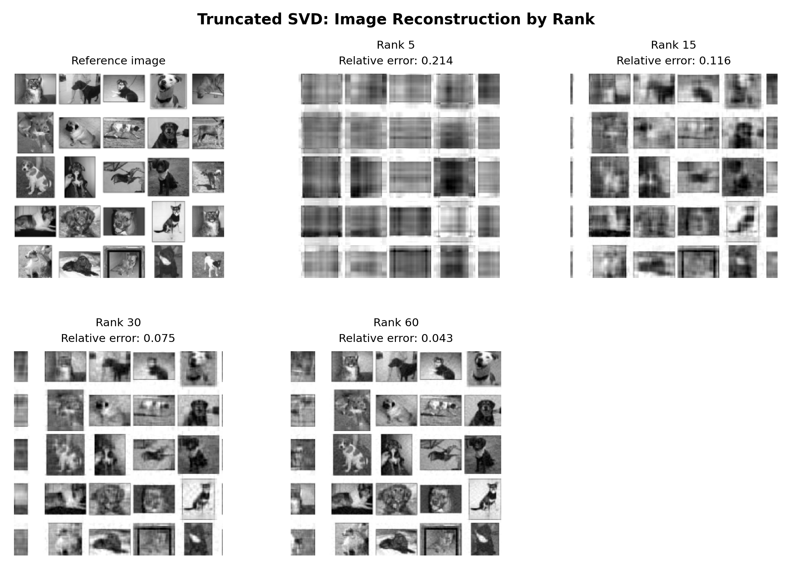
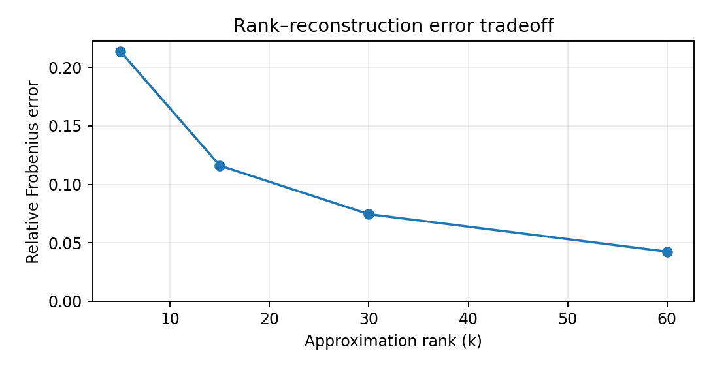

# Reproducible offline experiments

These results were generated from the **supplied scene and template files** using the cleaned implementation and a fixed NumPy random seed (`42`). This is an illustrative robustness check on one pair of images, **not** population-level accuracy or a benchmark.

## Template matching under Gaussian template noise

| Noise standard deviation (0–255) | Method | Best-match top-left (x, y) | Match score |
|---:|---|---|---:|
| 0 | SSD | `(462, 171)` | 104832.00000 |
| 0 | CORRELATION | `(462, 171)` | 0.99605 |
| 5 | SSD | `(462, 171)` | 153268.00000 |
| 5 | CORRELATION | `(462, 171)` | 0.99405 |
| 10 | SSD | `(462, 171)` | 316988.00000 |
| 10 | CORRELATION | `(462, 171)` | 0.98762 |
| 20 | SSD | `(462, 171)` | 940992.00000 |
| 20 | CORRELATION | `(462, 171)` | 0.96418 |
| 30 | SSD | `(462, 171)` | 1974420.00000 |
| 30 | CORRELATION | `(462, 171)` | 0.92746 |

**Interpretation:** SSD scores and normalized-correlation scores have different scales and optimization directions; never directly compare their raw numbers. The experiment perturbs the *template* and searches the same fixed scene.

## SVD rank analysis

The image was resized to fit a 300-pixel maximum dimension before computing full SVD for this illustrative comparison. Relative error is `||A - A_k||_F / ||A||_F`.

| Rank | Relative Frobenius error |
|---:|---:|
| 5 | 0.21357 |
| 15 | 0.11600 |
| 30 | 0.07450 |
| 60 | 0.04251 |

## Validation boundary

- Original course report: extensive research and individual example demonstrations.
- New offline measurements: only the supplied sample images and rank sweep above.
- Olivetti PCA retrieval: code provides a reproducible image-disjoint split, but a verified run on the dataset is not included in this package.
- No tested claim of superior accuracy, speed, scale invariance or robust biometric identification is made.
